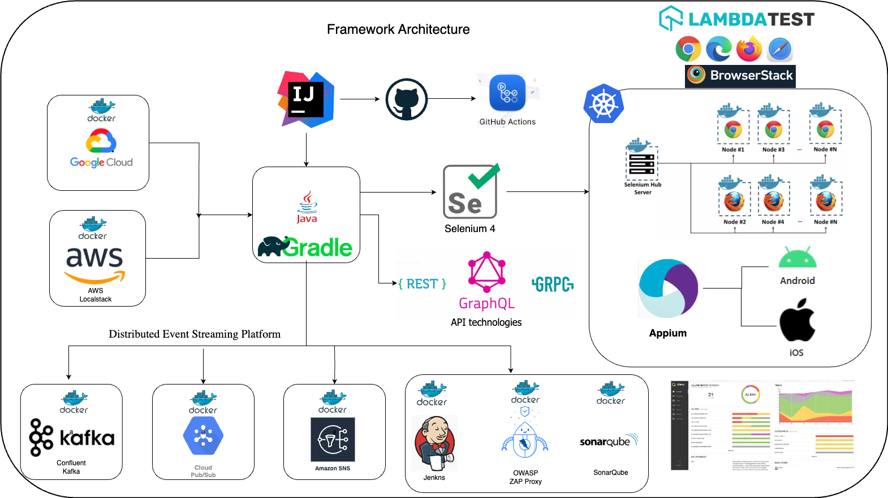
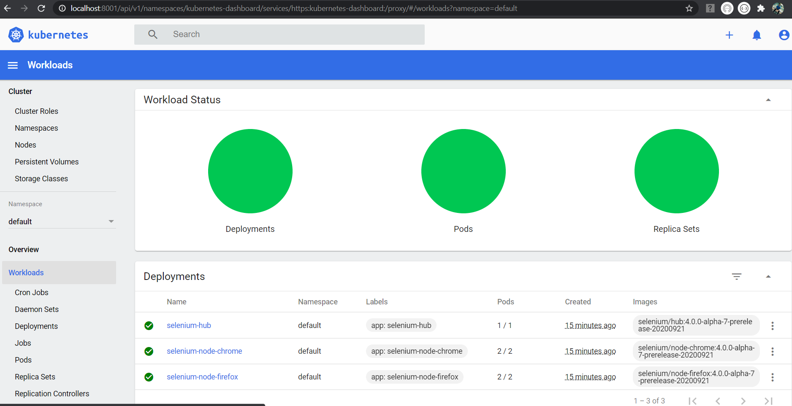

# HybridTestFramework

[](https://www.codacy.com/gh/dipjyotimetia/HybridTestFramework/dashboard?utm_source=github.com&amp;utm_medium=referral&amp;utm_content=dipjyotimetia/HybridTestFramework&amp;utm_campaign=Badge_Grade)
[](https://percy.io/CypressTest/Selenium)
[](https://github.com/dipjyotimetia/HybridTestFramework/actions/workflows/gradle.yml)  
[](https://discord.gg/eE3gjXqXHx)

Docs: [dipjyotimetia.github.io/HybridTestFramework](https://dipjyotimetia.github.io/HybridTestFramework/)

### Supported By

[](https://www.jetbrains.com/?from=HybridTestFramework)


HybridTestFramework is a Java 17 / Gradle end-to-end test framework for web, mobile, API, gRPC, Kafka, cloud, and security checks.

It is for developers and testers who want those layers in one TestNG project, with suites under `src/test/java/suite`.

Shared actions, Allure reports, and Testcontainers keep local runs and CI on the libraries declared in `build.gradle`.



## Capability matrix

Each row is a library or client that `build.gradle` declares and that `src/` actually calls. There is no Maven `pom.xml`; versions live in the root `build.gradle` and `contract/build.gradle`.

| Capability | Tool |
| --- | --- |
| Web | Selenium Java (`org.seleniumhq.selenium:selenium-java`) and Playwright (`com.microsoft.playwright`). Remote grids in `WebOptions`: BrowserStack, LambdaTest, Sauce Labs, and `http://localhost:4445/wd/hub`. |
| Mobile | Appium Java Client (`io.appium:java-client`). `MobileOptions` builds BrowserStack, LambdaTest, and Sauce Labs capabilities. |
| API | REST Assured (`io.rest-assured:rest-assured`) for REST and GraphQL. WireMock (`org.wiremock:wiremock`) for stubs. |
| gRPC | gRPC Java (`io.grpc`) with protobuf in `contract/src/main/proto` (`contract/build.gradle`). |
| Kafka / events | Apache Kafka clients (`org.apache.kafka:kafka-clients`), CloudEvents (`io.cloudevents`), Google Cloud Pub/Sub, and AWS SNS (`com.eventing`). |
| Cloud | AWS SDK for Java v2 (`software.amazon.awssdk`: S3, SQS, SNS) and Google Cloud Pub/Sub. Testcontainers modules in use: Kafka, LocalStack, and the Pub/Sub emulator. |
| Security | OWASP ZAP client (`org.zaproxy:zap-clientapi`) in `com.security`, with the ZAP daemon service in `docker-compose-infra.yml`. |

`web` and `mobile` default to BrowserStack (`webng.xml`, `mobileng.xml`). `lambdaweb` and `lambdamobile` use the LambdaTest suites. gRPC (`TC009_GrpcApi`) and GraphQL (`TC004_GraphQLTest`) are implemented and commented out of `aping.xml`. `TC002_SecurityTest` is not attached to a suite XML.

## Quick Start

JDK 17 is enough for the WireMock path. The wrapper downloads Gradle 8.12. Docker is required for `./gradlew api` (Testcontainers) and for the compose files below.

```bash
git clone https://github.com/dipjyotimetia/HybridTestFramework.git
cd HybridTestFramework
chmod +x gradlew
./gradlew api --tests com.TestDefinitionLayer.TC005_WireMockTest
./gradlew allureReport
```

`TC005_WireMockTest` is the in-process WireMock class in `src/test/java/suite/aping.xml`. The report is written to `build/reports/allure-report`. To browse it:

```bash
./gradlew allureServe
```

The same tasks are registered in `build.gradle` and invoked from `.github/workflows/gradle.yml`:

```bash
./gradlew api
./gradlew web
./gradlew lambdaweb
./gradlew mobile
./gradlew lambdamobile
```

`./gradlew api` runs the REST booking test, WireMock, Kafka (`TC006_KafkaTest`), and the Pub/Sub emulator (`TC010_GCPTest`). Kafka and Pub/Sub start Testcontainers, so Docker has to be running. Before `api`, CI also runs `docker compose up -d` (LocalStack and stripe-mock from `docker-compose.yml`).

`web` and `mobile` need `BROWSERSTACK_USERNAME` and `BROWSERSTACK_ACCESS_KEY`. `lambdaweb` and `lambdamobile` need `LT_USERNAME` and `LT_ACCESS_KEY`.

## Setup

* JDK 17: https://adoptium.net/temurin/releases/?version=17
* Docker: https://www.docker.com/products/docker-desktop
* IntelliJ IDEA: https://www.jetbrains.com/idea/download/
* Gradle comes from `./gradlew` (8.12). Allure is the `io.qameta.allure` plugin (`allureReport` / `allureServe`), version `2.32.0` in `build.gradle`.

## Tests

Classes are in `src/test/java/com/TestDefinitionLayer`. Suites are in `src/test/java/suite`.

`TC001_Test` is the Selenium web login (`@Link`, `@Feature`, `@Severity`). `TC003_ApiTest` is the REST Assured booking call. `TC002_GURU_Login` is the Playwright example.

## Docker

### LocalStack and stripe-mock

`docker-compose.yml` is what CI starts before the API job:

```bash
docker compose up -d
docker compose down
```

### Allure service and OWASP ZAP

`docker-compose-infra.yml`:

```bash
docker compose -f docker-compose-infra.yml up -d
docker compose -f docker-compose-infra.yml down
```

### Kafka API (Redpanda)

`docker-compose-kafka.yml`:

```bash
docker compose -f docker-compose-kafka.yml up -d
docker compose -f docker-compose-kafka.yml down --rmi all
```

### Selenoid grid

`docker-compose-grid.yml` starts Selenoid and Selenoid UI:

```bash
docker compose -f docker-compose-grid.yml up -d
docker compose -f docker-compose-grid.yml down
```

## Kubernetes

`selenium-k8-deploy-svc.yaml` deploys `selenium-hub`, `selenium-node-chrome`, and `selenium-node-firefox`.

```bash
kubectl apply -f selenium-k8-deploy-svc.yaml
kubectl apply -f https://raw.githubusercontent.com/kubernetes/dashboard/v2.5.0/aio/deploy/recommended.yaml
kubectl proxy
kubectl describe secret -n kube-system | grep deployment -A 12
# To delete deployments
kubectl delete deployment selenium-node-firefox
kubectl delete deployment selenium-node-chrome
kubectl delete deployment selenium-hub
```

Dashboard: `http://localhost:8001/api/v1/namespaces/kubernetes-dashboard/services/https:kubernetes-dashboard:/proxy/`



## BrowserStack


